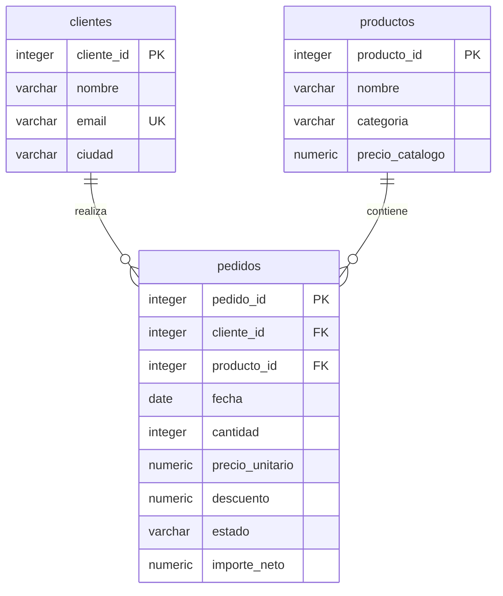

# PetStop: análisis exploratorio de ventas en PostgreSQL

Proyecto Capstone de SQL — Mateo Sapia. Septiembre de 2026.

## Problema de negocio

PetStop es una tienda ficticia de mascotas que necesita priorizar su surtido y sus acciones de fidelización. El análisis responde ocho preguntas sobre clientes, evolución mensual, productos de baja rotación, ranking de pedidos, categorías y calidad de datos. El período analizado es enero–junio de 2026. Los importes están expresados en pesos argentinos nominales y representan ingresos netos del descuento, sin costos, impuestos ni ajustes por inflación.

**Los datos son sintéticos**, generados de forma determinística en `estructura.sql`. Se utiliza la opción de la consigna que permite crear tablas propias de clientes, pedidos y productos. Ningún registro describe personas o ventas reales. Las recomendaciones ilustran la interpretación de este caso académico; no son evidencia del mercado real.

## Archivos y ejecución

| Archivo | Contenido |
| --- | --- |
| `estructura.sql` | Esquema, carga reproducible, datos crudos, limpieza, rechazos y vistas de análisis |
| `analisis.sql` | Ocho consultas comentadas con JOIN, GROUP BY, HAVING, CTE, CASE y funciones de ventana |
| `resultados.json` | Resultados completos obtenidos al ejecutar las ocho consultas |
| `validacion.mjs` | Comprobaciones reproducibles usando PostgreSQL compilado a WebAssembly (PGlite) |
| `package.json` / `package-lock.json` | Dependencia fijada para repetir la validación |

### PostgreSQL con psql

Requisito: PostgreSQL 14 o posterior y una cuenta que pueda crear la base. Desde una terminal, usando las credenciales de tu instalación:

```sh
createdb -U postgres capstone_project
psql -U postgres -d capstone_project -v ON_ERROR_STOP=1 -f estructura.sql
psql -U postgres -d capstone_project -v ON_ERROR_STOP=1 -f analisis.sql
```

Si la base ya existe, omití `createdb`. En pgAdmin, ejecutá `CREATE DATABASE capstone_project;` una sola vez, fuera de una transacción; después abrí Query Tool sobre esa base y ejecutá primero `estructura.sql` y después `analisis.sql`. El archivo de estructura recrea **solo** el esquema académico `petstop_capstone`; no lo uses para conservar modificaciones manuales dentro de ese esquema.

### Repetir la validación sin instalar un servidor

```sh
npm ci
npm test
```

Se comprobó el SQL realmente en **PostgreSQL 18.3, PGlite 0.5.8 (WebAssembly)**. No se afirma una ejecución en pgAdmin ni en un servidor nativo. La validación ejecuta la carga dos veces, corre las ocho consultas y comprueba filas, tratamiento de nulos, meses completos, productos sin ventas y rechazo de una clave foránea inválida. `resultados.json` registra el motor y todos los resultados. Las instrucciones de creación de la base son para PostgreSQL nativo; PGlite proporciona una base aislada para las pruebas y no ejecuta `CREATE DATABASE`.

## Modelo y unidad de análisis



Una fila de `pedidos` representa un pedido de **un único producto** y una o más unidades, simplificación declarada del caso. No hay pedidos de varias líneas: por ello sumar `importe_neto` o contar `pedido_id` no duplica cabeceras. Para extender a un carrito real se separarían `pedidos` y `detalle_pedido`. Las PK/FK aseguran que cada JOIN hacia cliente o producto conserve una fila por pedido. El precio de la venta se almacena en el pedido para no recalcular ingresos históricos cuando cambie el catálogo.

El conjunto contiene 12 clientes, 9 productos y 6 meses. Las claves y atributos usan `INTEGER`, `DATE`, `NUMERIC` y `VARCHAR`; se aplican `NOT NULL`, `UNIQUE`, claves foráneas y restricciones `CHECK` para cantidad, precio, descuento y estado.

## Limpieza y decisiones sobre valores ausentes

1. `pedidos_raw` conserva 123 filas originales. Una copia idéntica se detecta con `ROW_NUMBER()` y se aparta, manteniendo el primer registro por ID.
2. Se recuperan 7 precios faltantes con `COALESCE(precio_unitario, precio_catalogo)`. Esto es válido **solo bajo la premisa del dataset sintético de catálogo estable**. Se conserva `precio_recuperado` para medir su impacto; en datos reales sería necesario un historial de precios vigente en la fecha de venta.
3. Se recuperan 3 fechas con `COALESCE(fecha, fecha_confirmacion)`: la segunda es una fecha de la misma operación. No se inventa la fecha actual ni una fecha promedio. Un registro sin ambas fechas va a rechazos.
4. Un descuento nulo se trata como cero por la regla de negocio del generador, que significa ausencia de promoción. Se normaliza el estado con `LOWER(BTRIM(...))`.
5. Se excluye del modelo limpio una cantidad igual a cero. `rechazos` conserva tres registros y su motivo: duplicado, cantidad no válida y fecha no recuperable.
6. Quedan 120 pedidos válidos, de los cuales 10 cancelados se excluyen de ingresos y 110 completados se analizan. No se borran los datos crudos ni los cancelados.

Conciliación: **123 = 120 + 3** y **120 = 110 + 10**. No quedan nulos en fecha o precio de la tabla limpia. En los reportes se usa `COALESCE` para representar cero ventas cuando un LEFT JOIN no encuentra coincidencias; no se confunde esa ausencia con un precio desconocido.

## Preguntas, resultados e interpretación

Los resultados completos y reproducibles se incluyen en `resultados.json`. La base analítica tiene **110 pedidos completados, 219 unidades e ingresos de $1.326.200**.

### 1. ¿Qué clientes concentran el mayor gasto?

| Cliente ficticio | Pedidos | Gasto total | Participación |
| --- | ---: | ---: | ---: |
| 09 | 11 | $147.000 | 11,08% |
| 10 | 11 | $143.500 | 10,82% |
| 08 | 11 | $140.000 | 10,56% |
| 07 | 11 | $139.000 | 10,48% |
| 03 | 11 | $136.500 | 10,29% |

El grupo suma $706.000, aproximadamente **53,23%** del total. Todos tienen la misma frecuencia en este generador; la diferencia surge del importe y mezcla de productos. Una prueba de fidelización podría empezar por este grupo, midiendo recompra y margen incremental, sin asumir que un mayor gasto implica mayor rentabilidad.

### 2. ¿Cómo evolucionan ingresos y ticket mensual?

| Mes de 2026 | Pedidos | Ingresos | Ticket promedio | Cambio mensual |
| --- | ---: | ---: | ---: | ---: |
| Enero | 11 | $120.500 | $10.954,55 | No aplica |
| Febrero | 15 | $170.850 | $11.390,00 | +41,78% |
| Marzo | 16 | $214.250 | $13.390,63 | +25,40% |
| Abril | 20 | $260.600 | $13.030,00 | +21,63% |
| Mayo | 22 | $242.800 | $11.036,36 | -6,83% |
| Junio | 26 | $317.200 | $12.200,00 | +30,64% |

Mayo tiene más pedidos que abril, pero menos ingresos: el ticket promedio cae. Conviene revisar mezcla, cantidades y descuentos antes de atribuir la caída a captación. Junio recupera volumen y ticket. La serie incluye todos los meses y deja el cambio inicial nulo porque no hay diciembre para comparar. La tendencia es una propiedad del generador, no una estimación de crecimiento real.

### 3. ¿Qué tres productos tienen menor rotación?

El **Cepillo premium** no registra ventas, **Shampoo neutro** tiene 25 unidades y **Arena sanitaria** 26. El LEFT JOIN evita perder el producto de cero ventas. Primero se debería verificar disponibilidad, exposición y fecha de lanzamiento del cepillo; sin datos de stock no es válido concluir que no existe demanda ni eliminarlo del surtido automáticamente.

### 4. ¿Qué pedidos lideran por importe en su categoría?

`Q4` genera un ranking de los 110 pedidos mediante `RANK()` particionado por categoría. Los empates comparten posición; el ID solo ordena visualmente la salida. Sirve para auditar pedidos grandes y comparar operaciones dentro de un grupo semejante. No se fuerza un orden arbitrario entre importes iguales.

### 5. ¿Qué categorías lideran cada mes y superan su promedio?

`Q5` entrega las 18 combinaciones de 6 meses y 3 categorías, con ventas, posición mensual, acumulado y comparación con su promedio mensual del semestre. `CASE` distingue por encima, por debajo e igualdad. Esta referencia usa todo el semestre y es descriptiva, **no un pronóstico disponible en cada mes histórico**. Antes de evaluar campañas debería sustituirse por una referencia previa al período evaluado.

### 6. ¿Qué clientes no completaron compras?

Los clientes ficticios **11 y 12** tienen cero compras completadas: **2 de 12 registrados (16,67%)**. La acción ilustrativa sería investigar barreras de activación; no existe información suficiente para explicar la causa. El cálculo se basa en pedidos completados para no confundir una cancelación con conversión.

### 7. ¿Qué parte de los ingresos depende de precios recuperados?

**$74.900 (5,65%)** corresponden a operaciones cuyo precio se recuperó del catálogo. Excluirlas deja $1.251.300. Ese importe alternativo es una sensibilidad, no la verdad observada. También hay tres fechas recuperadas. En una operación real se priorizaría recuperar comprobantes antes de usar estos ingresos en una decisión financiera.

### 8. ¿Qué categorías aportan más ingresos?

| Categoría | Unidades | Ingresos | Participación |
| --- | ---: | ---: | ---: |
| Alimentos | 84 | $625.200 | 47,14% |
| Accesorios | 84 | $384.150 | 28,97% |
| Higiene | 51 | $316.850 | 23,89% |

Alimentos y accesorios venden las mismas unidades, pero alimentos aporta más ingresos por su mezcla de precios. Una propuesta de asignación de espacio necesitaría además margen, rotación del stock y vencimientos. El análisis evita llamar “rentabilidad” a una suma de ventas sin costos.

## Límites y próximos pasos

El pequeño dataset fue diseñado para verificar casos de calidad y técnicas SQL. No permite inferir causalidad, estacionalidad, elasticidad ni comportamiento de clientes reales. Faltan costos, inventario, devoluciones, campañas y fechas de alta. Como extensión se propone integrar esas fuentes, separar cabecera y detalle para carritos, comparar contra objetivos, verificar precios históricos y analizar cohortes con ventanas temporales completas.

## Correspondencia con la consigna

- Base `capstone_project`: instrucciones de creación y conexión incluidas.
- Tablas clientes, productos y pedidos con datos propios: `estructura.sql`.
- Limpieza previa y `COALESCE` en precios y fechas: staging, preparación, rechazos y carga limpia.
- Top 5 clientes, ventas mensuales, tres productos menos vendidos y ranking con `RANK()`: Q1–Q4.
- Al menos cinco preguntas y combinación de dos o más tablas: ocho preguntas y vista que une tres tablas.
- `GROUP BY`, funciones de ventana, `CASE`, comentarios y hallazgos interpretados: consultas y README.
- Verificación ejecutable: motor, comprobaciones y resultados guardados; no se simulan capturas ni evidencias.
